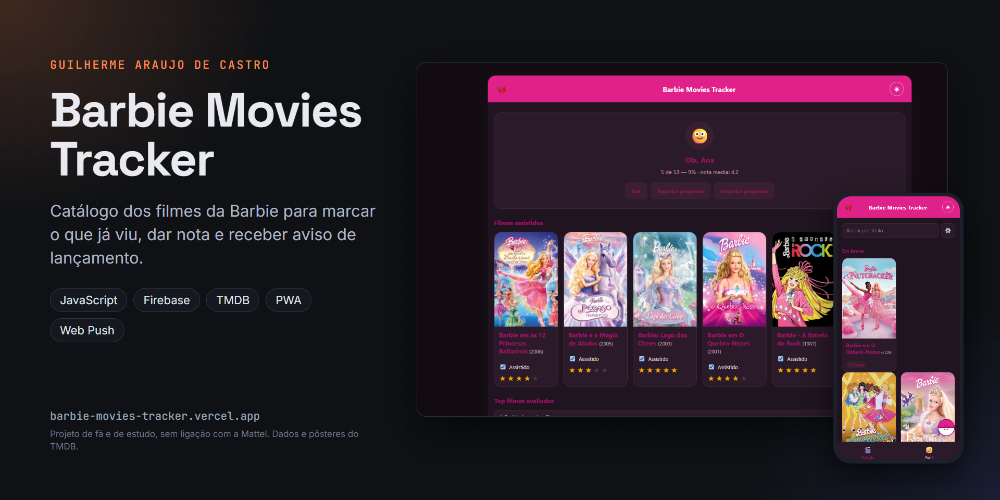
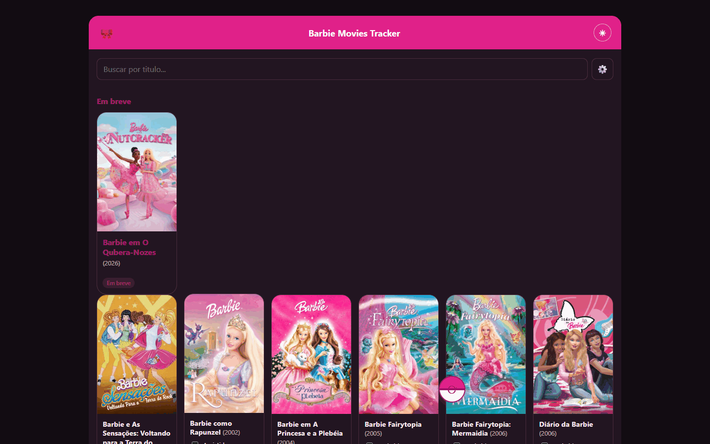
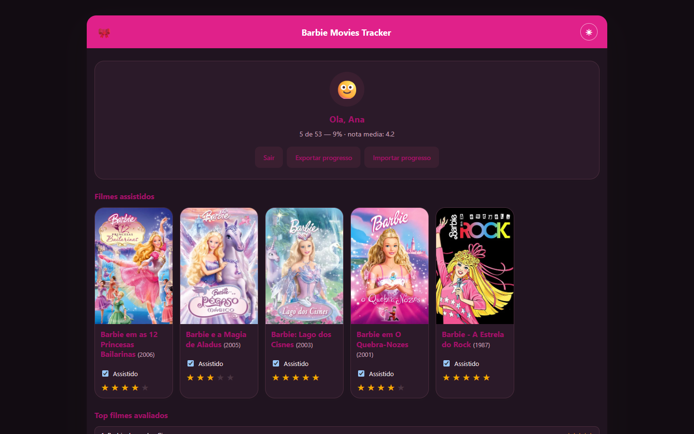
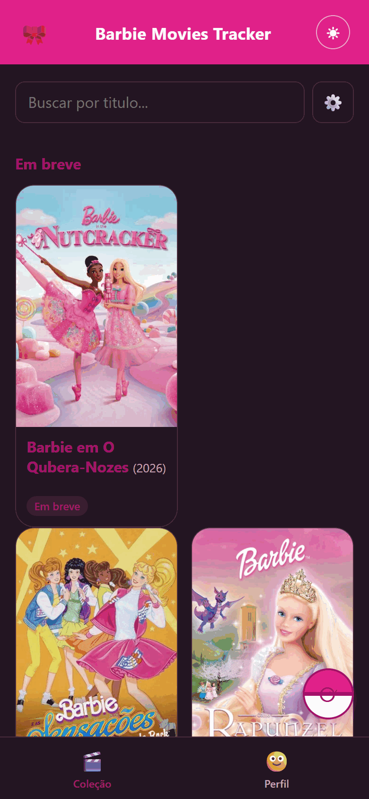

# Barbie Movies Tracker



Catálogo dos filmes da Barbie pra marcar os que você já viu, dar nota, escrever uma resenha curta e acompanhar o progresso. Os dados dos filmes vêm do TMDB.

Site: https://barbie-movies-tracker.vercel.app

[](https://github.com/GuilhermeAraujoDeCastro/barbie-movies-tracker/actions/workflows/ci.yml)

| Coleção | Perfil e estatísticas | No celular |
|---|---|---|
|  |  |  |

## O que tem

- Lista dos filmes da franquia com capa, ano e gênero, busca, filtro por ano e por não vistos, e seções separadas pros vistos, os que faltam e os que ainda vão lançar. Enquanto o TMDB responde, aparecem cards de carregamento no lugar da tela em branco.
- Ordem alfabética, por ano ou por nota.
- Ficha de cada filme com sinopse, elenco, duração, nota de 1 a 5 e resenha.
- Barra de progresso e estatísticas: gêneros mais vistos, nota média por década, filmes mais bem avaliados e o ano com mais lançamentos que você viu.
- Modo visitante, que guarda tudo no próprio navegador, sem conta.
- Login com Google ou e-mail pelo Firebase, pra levar o progresso pra outros aparelhos.
- Compartilhamento opcional por link só leitura, com revogação e geração de outro link. A coleção da conta é privada por padrão. A comparação usa o token público recebido.
- Backup JSON versionado e importação de volta, incluindo lista Quero assistir, prioridades e datas. Exportação CSV com títulos, notas, resenhas e datas, com proteção contra fórmulas de planilha.
- Lista Quero assistir com três prioridades, separada da marcação de assistido.
- Data assistida editável e diário mensal; datas antigas desconhecidas continuam em branco.
- Notificação quando sai filme novo da Barbie no TMDB (opcional).
- Um aviso curto na primeira visita explicando os modos visitante, Google e e-mail.
- Tema claro e escuro, layout pra celular e instalação como app (PWA).

## Como a lista é montada

Buscar "Barbie" no TMDB traz muito filme sem relação com a franquia. Por isso a lista (em `js/tmdb.js`) junta a busca por texto com os filmes das produtoras da Mattel. Animação e família entram; terror, crime, documentário e guerra saem. Título sem a Mattel entre as produtoras só aparece se tiver um mínimo de votos no TMDB.

## Tecnologias

JavaScript puro em módulos ES, sem framework. Firebase Authentication autentica as contas e Firestore guarda o progresso; o modo visitante usa `localStorage`. A notificação de filme novo roda numa function da Vercel (`api/notify-new-movies.js`) com web-push e firebase-admin, agendada pelo cron da Vercel uma vez por dia. O Sentry é opcional, pra acompanhar erros em produção.

O build gera uma cópia em `dist/` e mantém a fonte legível. Nessa cópia, os nomes internos do JavaScript são encurtados e o JS, o CSS e o HTML saem minificados, o que deixa os arquivos menores. Isso não protege nada: qualquer pessoa ainda consegue ler o que roda no navegador. O que é segredo de verdade (a chave do TMDB e a conta de serviço do Firebase) fica só nas functions da Vercel.

## Estrutura

```
barbie-movies-tracker/
├── index.html
├── sw.js                    service worker (cache offline)
├── manifest.json
├── firestore.rules          regras de segurança do banco
├── vercel.json              build e cron da notificação
├── api/
│   ├── notify-new-movies.js
│   └── tmdb.js              proxy da TMDB (a chave fica no servidor)
├── css/
├── js/
│   ├── main.js              liga a tela aos módulos
│   ├── tmdb.js              busca e filtro dos filmes
│   ├── filters.js, progress.js, ratings.js, reviews.js, stats.js
│   ├── storage-local.js     modo visitante
│   ├── firebase-app.js      login e dados na nuvem
│   ├── collection.js        modelo, datas e diferenças por filme
│   ├── pending-reviews.js   tarefas de resenha vinculadas à sessão
│   ├── demo.js              catálogo fixo, sem API
│   ├── backup.js
│   └── config.example.js    modelo das chaves
└── scripts/                 build e servidor local
```

## Rodando na sua máquina

Use Node.js 22 ou superior. Esta revisão foi validada com Node.js 24.22.1. As dependências de build estão no `package.json`; a aplicação usa módulos ES no navegador.

```bash
npm install
copy js\config.example.js js\config.js
npm run dev
```

No Linux ou no macOS, troque o `copy` por `cp js/config.example.js js/config.js`. Preencha o `js/config.js` com a sua chave do TMDB; as instruções estão no próprio arquivo. O Firebase só é necessário pro login, pro link público e pras notificações. O `js/config.js` fica fora do git.

## Demonstração e testes locais

Com `npm run dev`, abra `http://localhost:5173/?demo=1`. Esse modo entra num visitante fictício, usa três filmes de um catálogo fixo e separa seu armazenamento dos perfis normais. Ele não inicializa Firebase, TMDB, Sentry ou service worker. Adicione um filme a Quero assistir, defina a prioridade, marque outro como assistido, avalie e edite a data na ficha. O Perfil mostra o diário e permite baixar o CSV. O parâmetro opcional `returnTo` aceita apenas HTTP/HTTPS de localhost, 127.0.0.1 ou do portfólio público.

```bash
npm test
npm run build
```

`npm test` executa 9 regressões com `node:test`: alterações concorrentes de filmes e campos, migração, compartilhamento, tarefas de resenha, watchlist, datas, CSV e o servidor local. O teste HTTP inicia um processo próprio em porta livre e verifica `/?demo=1`, um asset, bloqueio de traversal e URL malformada. Os testes de transação usam um SDK falso em memória; não comprovam as regras do Firestore. O teste HTTP não substitui a navegação interativa.

Para as regras, instale Firebase CLI e Java 21 num ambiente local. Em um terminal deste projeto:

```bash
firebase emulators:start --only auth,firestore --project demo-auditoria-tracker
```

Em outro terminal:

```bash
npm run test:rules
```

Os testes aceitam apenas `127.0.0.1`, Auth na porta 9199, Firestore na 8180 e o projeto `demo-auditoria-tracker`. Eles carregam regras anteriores como fixture para reproduzir o problema e depois validam as regras novas com contas fictícias. Não execute os dois trackers ao mesmo tempo nessas portas. Para testar a interface autenticada com o emulador e catálogo fixo, rode `npm run local:emulator` antes de `npm run dev`; ele prepara `js/config.js` com identificadores fictícios e conexão explícita aos emuladores. Esse arquivo fica fora do Git.

Na revisão local, nove regressões Node e sete casos de regras passaram. Dois clientes Firebase no emulador preservaram edições concorrentes em filmes e campos distintos. No Edge com Playwright, a coleção compartilhada ficou em modo somente leitura. A rotação e a revogação invalidaram os links anteriores, e sair antes da gravação de uma resenha preservou a resenha anterior sem transferir o rascunho à segunda conta. A ficha pública foi conferida a 390 px.

Os formulários de entrada aguardam a inicialização do JavaScript. Um teste com atraso controlado reproduziu a submissão nativa anterior, interceptada no navegador com dados fictícios. A versão corrigida bloqueou o envio prematuro e liberou o login no emulador. TMDB, login real e regras publicadas não foram exercitados nesse teste.

## Persistência, migração e privacidade

O progresso novo fica em `progress/{uid}/movies/{movieId}`. Cada transação altera somente os campos modificados do filme e lê o estado atual antes de gravar. Alterações em filmes ou campos diferentes se preservam; para o mesmo campo, vale a última transação confirmada. A tela de outro aparelho recebe os demais dados ao recarregar; não há atualização contínua entre dispositivos.

No primeiro login, o formato antigo é copiado para os documentos por filme, sem substituir documentos que já existam. Os mapas antigos continuam no documento original como cópia de segurança. O marcador `schemaVersion: 2` torna a migração idempotente. A migração e o compartilhamento limitam a coleção a 200 filmes e recusam excedentes com erro. Exporte JSON e ensaie com dados fictícios antes de aplicar regras ou migração em outro ambiente.

O compartilhamento cria `shares/{token}/movies/{movieId}`. Cada leitura pública verifica o token ativo do dono. Revogar ou gerar outro link impede novas leituras pelo token anterior. Os links antigos baseados em UID deixam de funcionar com as novas regras. A cópia pública inclui marcação, nota, resenha, prioridade e data; publique apenas o que quiser compartilhar. A revogação não apaga arquivos ou conteúdo que alguém já tenha recebido.

Os perfis visitantes passam para `barbie-tracker:guest:v2:<nome codificado>`. A leitura copia um perfil legado válido para esse namespace e mantém a chave antiga. Se uma chave antiga já foi sobrescrita por uma preferência de tema, o app não consegue recuperar os dados perdidos.

Resenhas pendentes são canceladas ao sair ou trocar de sessão, para impedir gravação no perfil seguinte. Um rascunho ainda sem salvamento pode ser descartado ao sair. Falhas de sincronização aparecem na tela; exporte um backup antes de fechá-la. O progresso da nuvem exige conexão para transações; não há promessa de sincronização offline.

A configuração web do Firebase é pública. A chave do TMDB usada pelo proxy, as credenciais administrativas e a chave privada de push pertencem ao servidor. O arquivo `.env.example` lista os nomes sem valores reais. Nunca coloque esses segredos em `js/config.js`.

## Configuração de hospedagem

O build gera o `js/config.js` a partir das variáveis de ambiente do projeto na Vercel, então as chaves não ficam no repositório:

- `TMDB_API_KEY`, que fica só no servidor: no site publicado o navegador busca os filmes por `api/tmdb.js`, que acrescenta a chave
- `FIREBASE_API_KEY`, `FIREBASE_AUTH_DOMAIN`, `FIREBASE_PROJECT_ID`, `FIREBASE_STORAGE_BUCKET`, `FIREBASE_MESSAGING_SENDER_ID`, `FIREBASE_APP_ID`
- opcionais: `SENTRY_DSN` e `VAPID_PUBLIC_KEY`

A function de notificação também usa `VAPID_PRIVATE_KEY`, `VAPID_SUBJECT`, `FIREBASE_CLIENT_EMAIL`, `FIREBASE_PRIVATE_KEY` e `CRON_SECRET`. Sem o `CRON_SECRET` ela recusa qualquer chamada, inclusive a do cron. Só avisa filme lançado nos últimos 60 dias ou que ainda vai sair.

O GitHub Actions roda o build de produção a cada push, com chaves falsas, pra pegar erro antes da Vercel.

As regras ficam em `firestore.rules`. Esta revisão prepara e testa arquivos locais; nenhuma regra foi publicada. A configuração da Vercel agora aponta a saída estática para `dist/`. A publicação e a aplicação das regras dependem da revisão manual do proprietário.

## Créditos e avisos

Dados e pôsteres dos filmes vêm do [TMDB](https://www.themoviedb.org/); detalhes em [CREDITS.md](CREDITS.md). Barbie é marca da Mattel. Este é um projeto de fã e de estudo, sem fins lucrativos e sem ligação com a Mattel ou com o TMDB.

## Licença e contato

Código sob a licença MIT (veja [LICENSE](LICENSE)). Feito por Guilherme Araujo de Castro: [portfólio](https://guilhermearaujodecastro.vercel.app) · [LinkedIn](https://www.linkedin.com/in/guilherme-araujo-de-castro) · guilhermeacastro.2006@gmail.com
